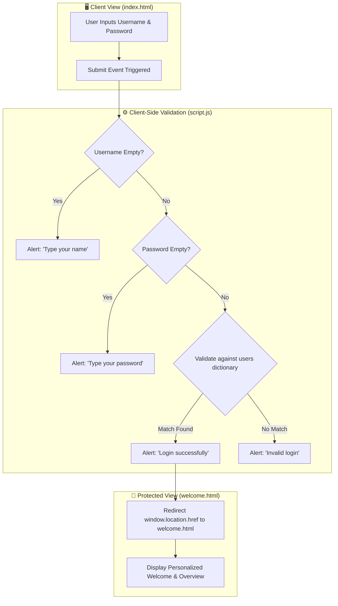

# 🔐 Client-Side Authentication & Login Flow

[](https://ranjithbrs.github.io/login-page-project/)
[](index.html)
[](style.css)
[](script.js)
[](LICENSE)

> A responsive client-side authentication interface built with semantic HTML5, CSS3 styling, and JavaScript form validation. Features DOM validation logic, credential verification, and client-side page navigation to a protected welcome portal.

---

## 🌐 Live Application

- 🚀 **Live Demo:** [ranjithbrs.github.io/login-page-project](https://ranjithbrs.github.io/login-page-project/)
- 🐙 **GitHub Repository:** [github.com/ranjithbrs/login-page-project](https://github.com/ranjithbrs/login-page-project)

---

## 📑 Table of Contents
- [Authentication Workflow](#-authentication-workflow)
- [Pre-Configured Demo Credentials](#-pre-configured-demo-credentials)
- [Key Features](#-key-features)
- [Repository Structure](#-repository-structure)
- [Local Setup & Running](#-local-setup--running)
- [Author & Connect](#-author)
- [License](#-license)

---

## 📐 Authentication Workflow



---

## 🔑 Pre-Configured Demo Credentials

Test the client-side login validation using any of the following accounts:

| Username | Password | Access Status |
| :--- | :--- | :--- |
| `Ranjith` | `1234` | ✅ Authorized |
| `Arun` | `abcd` | ✅ Authorized |
| `Priya` | `pass123` | ✅ Authorized |
| `Kumar` | `9876` | ✅ Authorized |

---

## ✨ Key Features

- **Form Validation**: Evaluates empty form fields and guards against null/empty input submissions.
- **Client-Side Authorization**: Verifies user identity against internal dictionary hash structures.
- **Responsive Layout**: Centered, card-style login view optimized for both mobile and desktop screens.
- **Smooth Navigation**: Seamless programmatic redirection from login gatekeeper (`index.html`) to protected welcome view (`welcome.html`).

---

## 📁 Repository Structure

```text
login-page-project/
├── index.html                  # Main authentication form interface
├── welcome.html                # Post-login destination view
├── style.css                   # Responsive layout and styling
├── script.js                   # Client-side validation and redirect logic
├── LICENSE                     # MIT open source license
└── README.md                   # Project documentation
```

---

## 🚀 Local Setup & Running

1. **Clone the repository:**
   ```bash
   git clone https://github.com/ranjithbrs/login-page-project.git
   cd login-page-project
   ```

2. **Open in Browser:**
   Simply double-click `index.html` or run with any static server:
   ```bash
   npx serve .
   ```

---

## 👨‍💻 Author

**Ranjith B**  
🎓 *B.Tech Computer Science & Business Systems (CSBS)*  
🏛️ *Nehru Institute of Engineering and Technology, Coimbatore*  

- 💼 **LinkedIn**: [linkedin.com/in/ranjith-b-85907831a](https://linkedin.com/in/ranjith-b-85907831a)  
- 🐙 **GitHub**: [github.com/ranjithbrs](https://github.com/ranjithbrs)  
- 🌐 **Portfolio**: [ranjithbrs.github.io/portfolio](https://ranjithbrs.github.io/portfolio/)  
- 📧 **Email**: ranjithb2k06@gmail.com  

---

## 📄 License

This project is licensed under the [MIT License](LICENSE).
