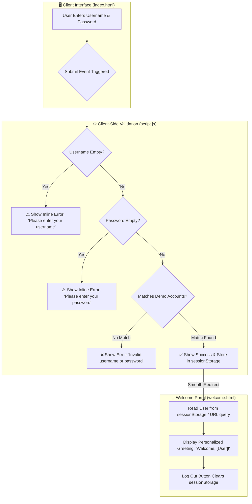

# 🚪 Frontend Login Interface & Form Validation Prototype

[](https://ranjithbrs.github.io/login-page-project/)
[](index.html)
[](style.css)
[](script.js)
[](LICENSE)

> 💡 **An accessible, responsive frontend login interface and client-side form validation prototype built to practice DOM manipulation, input verification, and multi-page client state navigation.**

---

## 🧭 Live Demo & Code
- 🚀 **Live Application:** [ranjithbrs.github.io/login-page-project](https://ranjithbrs.github.io/login-page-project/)
- 🐙 **GitHub Repository:** [github.com/ranjithbrs/login-page-project](https://github.com/ranjithbrs/login-page-project)

---

## 🎯 Project Purpose & Learning Objectives

This project was built as a dedicated frontend engineering practice exercise to master core web fundamentals without relying on third-party frameworks or external libraries:

1. **Form Validation & Event Interception**:
   - Preventing standard browser form submission with `event.preventDefault()`.
   - Handling edge cases such as whitespace-only inputs, empty usernames, and empty passwords.
   - Providing non-blocking, accessible inline error feedback instead of disruptive `alert()` popups.

2. **Accessibility (a11y) & WCAG Compliance**:
   - Semantic HTML5 structure (`<main>`, `<header>`, `<section>`, `<aside>`).
   - Explicit `<label>` to `<input>` associations using matching `for` and `id` attributes.
   - Screen-reader friendly dynamic status announcements using `role="alert"` and `aria-live="polite"`.
   - Keyboard navigable controls with visible `:focus-visible` outline rings.

3. **Modern Responsive Design**:
   - Mobile-first card architecture styled with modern CSS Custom Properties (variables).
   - High-contrast visual hierarchy (Slate `#0f172a` and Indigo `#4f46e5`) exceeding WCAG AA contrast standards.
   - Smooth transitions, password visibility toggle (`Show` / `Hide`), and one-click demo account filler chips.

4. **Multi-Page Client State Navigation**:
   - Passing user session state across HTML pages using `sessionStorage` with graceful URL parameter fallback (`?user=...`).
   - Dynamic DOM personalization in `welcome.html` and clean session clearance on logout.

---

## 🔒 Important Security Disclaimer: Prototype vs. Production Authentication

> [!WARNING]
> **Educational Prototype Notice**: This repository demonstrates **frontend user interface design, DOM event handling, and client-side form validation**. In accordance with professional web security standards, client-side credential verification is **never** used for real-world authentication because client-side JavaScript is entirely inspectable and modifiable by any end-user via browser Developer Tools.

### How this Prototype Compares to Production Authentication:

| Architectural Component | This Frontend Prototype | Production Full-Stack Application |
| :--- | :--- | :--- |
| **Credential Storage** | Mock in-memory dictionary in `script.js` | Normalized database table (PostgreSQL / MySQL) |
| **Password Security** | Plaintext matching (for UI demonstration) | One-way salted hash (**BCrypt** / **Argon2id**) |
| **Verification Layer** | Browser client-side JavaScript | Secure server-side backend API (Spring Boot / Node / FastAPI) |
| **Network Transport** | Local browser memory | Encrypted HTTPS (TLS 1.3) protocol |
| **Session Management** | `sessionStorage` (tab-scoped) | `HttpOnly`, `Secure`, `SameSite` signed JWT or session cookie |

*For implementations of secure, production-grade authentication with password hashing and backend authorization, see my full-stack projects:*
* ☕ **[Online-Examination-System](https://github.com/ranjithbrs/Online-Examination-System)**: Spring Boot 3, Spring Security, BCrypt password encryption, and role-based access control.
* 🏥 **[MediQ Healthcare PWA](https://github.com/ranjithbrs/mediq-web)**: Supabase PostgreSQL authentication, row-level security (RLS), and JWT token management.

---

## 📐 Application Architecture & Flow



---

## 🔑 Pre-Configured Demo Accounts

For rapid testing and code reviews, the prototype includes pre-configured test credentials accessible via one-click chips:

| Username | Password | Role / Status |
| :--- | :--- | :--- |
| `Ranjith` | `1234` | ✅ Authorized Demo Account |
| `Arun` | `abcd` | ✅ Authorized Demo Account |
| `Priya` | `pass123` | ✅ Authorized Demo Account |
| `Kumar` | `9876` | ✅ Authorized Demo Account |

---

## 📁 Repository Structure

```text
login-page-project/
├── index.html        # Accessible login form interface & demo account triggers
├── welcome.html      # Protected destination view with personalized greeting
├── style.css         # Modern, responsive mobile-first dark UI styling
├── script.js         # Validation logic, DOM manipulation & sessionStorage handling
├── LICENSE           # Open-source MIT License
└── README.md         # Technical architecture & educational documentation
```

---

## 🛠️ Local Development & Quick Start

1. **Clone the repository:**
   ```bash
   git clone https://github.com/ranjithbrs/login-page-project.git
   cd login-page-project
   ```

2. **Open the interface:**
   * **Direct File Open:** Double-click `index.html` in your file manager.
   * **VS Code Live Server:** Right-click `index.html` $\to$ **Open with Live Server**.
   * **Python Simple Server:**
     ```bash
     python -m http.server 8000
     ```
     Navigate to `http://localhost:8000` in your web browser.

---

## 🎤 Placement & Technical Interview Defense Q&A

### Q1: "Why did you build this login page project, and what did you learn?"
> **Your Answer**: *"I built this project to master vanilla web development fundamentals—specifically accessible HTML5 form structures, CSS Flexbox responsive layouts, and JavaScript DOM event handling. It allowed me to practice intercepting submit events, managing clean client-side validation states without using disruptive browser `alert()` dialogs, and passing session state between separate pages using `sessionStorage`."*

### Q2: "Can client-side validation replace server-side validation?"
> **Your Answer**: *"Never. Client-side validation exists purely for user experience (UX)—it gives instant feedback before a network request is made. However, client-side validation can be bypassed easily by disabling JavaScript or sending requests directly via cURL or Postman. In production systems, server-side validation and authentication are mandatory, where passwords are encrypted with BCrypt and verified against a secure database backend."*

---

## 👤 Author & Connect

**Ranjith B**  
*Full-Stack Developer & AI Specialist | B.Tech Computer Science & Business Systems*  
*Nehru Institute of Engineering and Technology, Coimbatore, Tamil Nadu, India*

* 🌐 **Live Portfolio:** [ranjithbrs.github.io/portfolio](https://ranjithbrs.github.io/portfolio/)
* 💼 **LinkedIn:** [linkedin.com/in/ranjith-b-csbs](https://www.linkedin.com/in/ranjith-b-csbs/)
* 💻 **GitHub:** [@ranjithbrs](https://github.com/ranjithbrs)
* 📧 **Email:** [ranjithb2k06@gmail.com](mailto:ranjithb2k06@gmail.com)

---

## 📜 License

This project is open-source under the **[MIT License](LICENSE)**.
